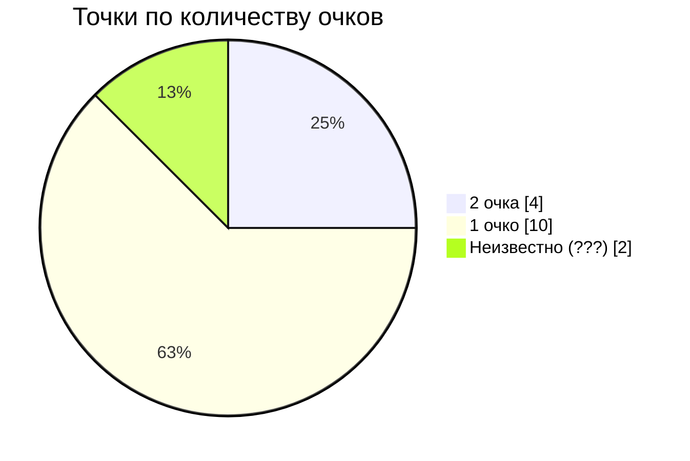
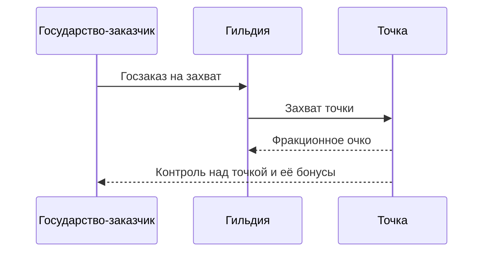

# ТОЧКИ ИНТЕРЕСА: МЕХАНИКА

Как фракции захватывают локации на карте, сколько людей для этого нужно и что это даёт. Описание самих локаций - в файле [Точки интереса](Точки%20интереса.md).

## Кто участвует

Сейчас в игре **4 государства** и **3 гильдии**. Каждая фракция может распространять влияние и наращивать ресурсы, захватывая локации на карте.

| Фракция | Тип | Участие в захватах | Если отстаёт по очкам |
|---|---|---|---|
| Скалица | Государство | Обязательно | Крупные дебаффы |
| Хальмштадт | Государство | Обязательно | Крупные дебаффы |
| Вирминд | Государство | Обязательно | Крупные дебаффы |
| Орд-Глас | Государство | Обязательно | Крупные дебаффы |
| Гильдия Авантюристов | Гильдия | По желанию | Без последствий |
| Гильдия Наёмников | Гильдия | По желанию | Без последствий |
| Гильдия Магов | Гильдия | По желанию | Без последствий |

- **Государства** с наименьшим числом фракционных очков получают крупные дебаффы на какое-то время, пока отставание не сократится.
- **Гильдии** могут не участвовать в войнах и захватах точек без последствий для себя. Зато даже 1-2 фракционных очка дают гильдии баффы.

## Фракционные очки

- Всего на карте **16 свободных фракционных очков**.
- За захват точки фракция получает **1 или 2 очка**, в зависимости от точки.
- У фракции с наибольшим числом очков больше всего привилегий в РП: дополнительное снабжение, урожаи, припасы. В целом её жизнь на какое-то время становится заметно приятнее.

### Текущее распределение

| Фракция | Очки |
|---|:-:|
| Скалица | 0 |
| Хальмштадт | 0 |
| Вирминд | 0 |
| Орд-Глас | 0 |
| ~~Гильдия Авантюристов~~ | - |
| ~~Гильдия Наёмников~~ | - |
| ~~Гильдия Магов~~ | - |

## Сколько людей нужно для захвата

| Тип точки | Точки | Нужно людей |
|---|---|:-:|
| Населённые пункты | Брамблбарроу, Эйблвуд, Редвуд, Аврехи | **6** человек личного состава |
| Особые | Вулкан Риолу, катакомбы, гробница | **Любое количество**, можно брать людей не из фракции («простаков с улицы») |
| Все остальные | - | **3** человека |

### Точки и очки

| Точка | Очки | Людей | Особые условия |
|---|:-:|:-:|---|
| Эйблвуд | 2 | 6 | - |
| Редвуд | 1 | 6 | - |
| Брамблбарроу | 1 | 6 | - |
| Аврехи | 1 | 6 | - |
| Подножья Мильдаруля | 1 | 3 | - |
| Прибрежный Лагерь | 1 | 3 | - |
| Вулкан Риолу | ??? | любое | Нужна экспедиция |
| Небесная кузня | 1 | 3 | Возможна «приватизация» за 200 золотых |
| Гостевой дом | 1 | 3 | - |
| Призрачный причал | 1 | 3 | Только при владении Страссехаусе |
| Парадиз | ??? | 3 | Только при владении Страссехаусе |
| Карьер | 2 | 3 | - |
| Кристальные пещеры | 1 | 3 | - |
| Маяк | 1 | 3 | - |
| Лесорубка | 1 | 3 | Текущий владелец: `@Georggg201` |
| Форпост «Страссехаусе» | 2 | 3 | Открывает захват точек в пустыне |

> [!NOTE]
> Очки в этой таблице взяты из описаний точек. В сумме известные значения дают 17, а в правилах сказано про 16 свободных очков, плюс у двух точек очки неизвестны («???»). Катакомбы и гробница упоминаются в правилах, но описаний этих точек пока нет.



## Как проходит захват

```mermaid
%%{init: {"flowchart": {"htmlLabels": false}}}%%
 TD
    A["Фракция выбирает точку"] --> B{"Точка в пустыне?"}
    B -- "Да" --> C{"Фракция владеет Страссехаусе?"}
    C -- "Нет" --> X["Захват невозможен"]
    C -- "Да" --> D{"Какой тип точки?"}
    B -- "Нет" --> D
    D -- "Населённый пункт" --> E["6 человек личного состава"]
    D -- "Вулкан, катакомбы, гробница" --> F["Любое число людей, можно не из фракции"]
    D -- "Остальные" --> G["3 человека"]
    E --> H["Захват под наблюдением ГМа, возможен ОПФОР"]
    F --> H
    G --> H
    H --> I{"Успех?"}
    I -- "Да" --> J["Фракционные очки и бонусы точки"]
    I -- "Нет" --> K["Точка не захвачена"]
```

**Важно:**
- Захват идёт **под наблюдением ГМа**. В зависимости от ситуации ГМ может добавить ОПФОР, но это не обязательно.
- Никто не гарантирует безболезненный захват точки или получение бонусов от неё.
- **За точки можно воевать.**

## Захват по госзаказу

Гильдии могут захватывать точки по государственному заказу. Тогда фракционное очко получает гильдия, а контроль над точкой и её бонусы переходят государству-заказчику.


