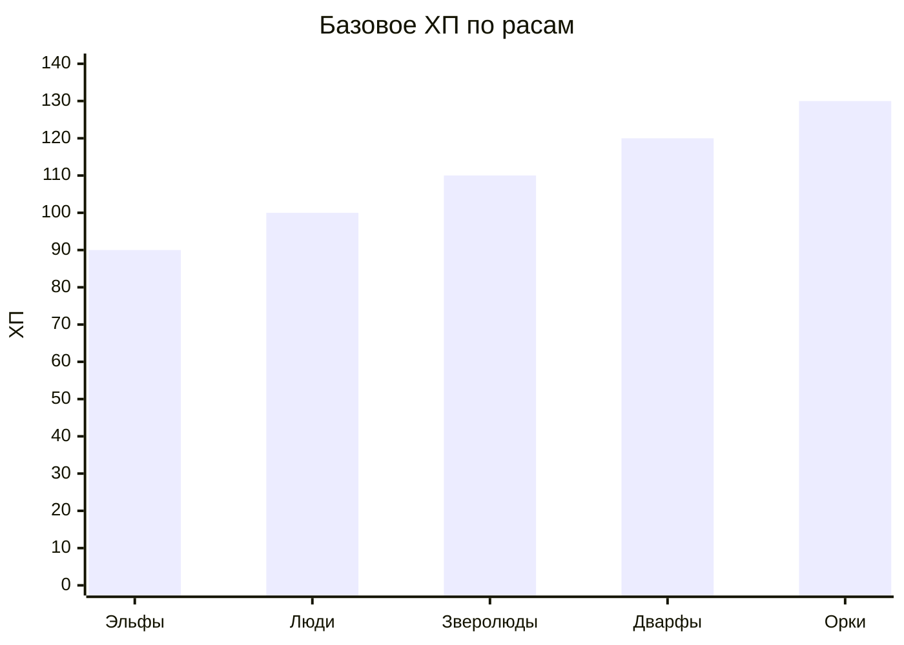
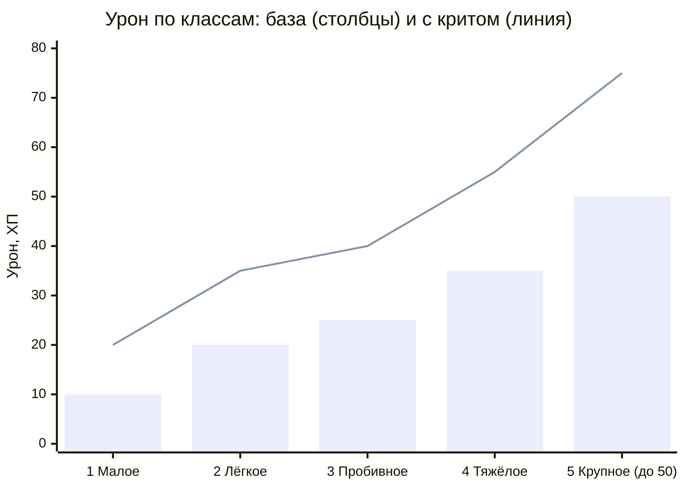
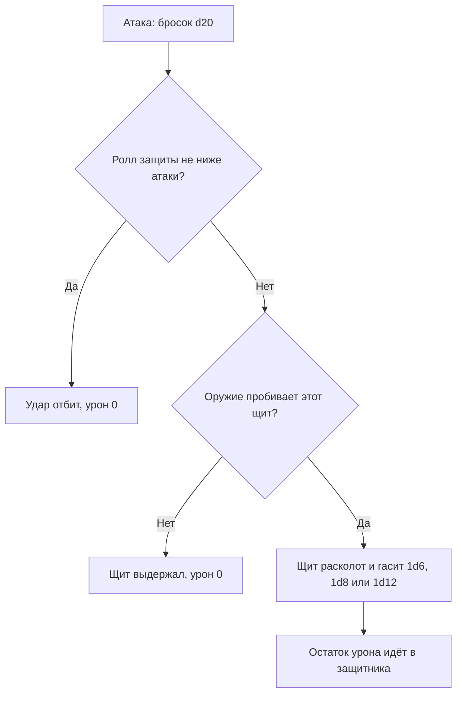
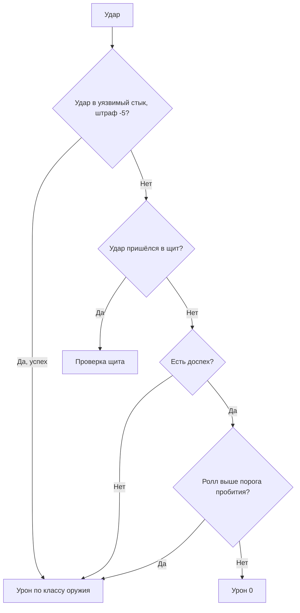
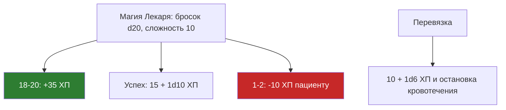

# СИСТЕМА ЗДОРОВЬЯ/УРОНА (Mythage)

*Документ может изменяться, об изменениях сообщат.*

## I. Что такое ХП
ХП - внутренний каркас из жизненной маны, удерживающий душу, кости и плоть вместе. Чем меньше ХП, тем страшнее увечья. **0 ХП - смерть.**
ХП выставляется в **EDIT > OUTFIT > INFO > STATS**.

## II. Базовое ХП по расам
Эталон - взрослый человек (100 ХП).

| Раса | ХП | Бонус к d20 |
|---|---|---|
| Эльфы | 90 | +2 к Уклонению и стрельбе из лука |
| Люди | 100 | +1 к любым броскам атаки и защиты |
| Зверолюды | 110 | +2 к Уклонению и атакам в ближнем бою |
| Дварфы | 120 | +2 к Силовому Блоку щитом/оружием и сопротивлению магии |
| Орки | 130 | +2 к Тяжёлым Атакам двуручным и древковым оружием |

Это база, остальное - в документе по расам. ХП боссов и особых сущностей - уточнять у ГМов/Анкетологов.

## Кубы
- **d20** - основной: атака, защита, пробитие доспехов и щитов, проверки навыков вне боя. **18-20 - крит. успех, 1-2 - крит. провал.**
- **d12** - гашение урона при пробитии Тяжёлого щита (или барьера архимага).
- **d10** - лечение магией (база + 1d10).
- **d8** - гашение урона при пробитии Среднего щита (или стандартного барьера).
- **d6** - периодический урон (кровотечение, горение, яд; в начале каждого хода раненого), гашение Лёгкого щита, перевязка вне боя (10 + 1d6 ХП).
- **d100** - глобальные сюжетные проверки по требованию ГМа.

## Урон по классам оружия
Применяется, если удар попал в незащищённое тело или пробил защиту.

| Класс | Оружие | Урон | Крит. удача (18-20) | Крит. провал (1-2): врагу 0, атакующий теряет |
|---|---|---|---|---|
| 1. Малое | Кулаки, кастеты, кинжал, стилет, метательный нож, удар древком/яблоком меча (без Мордхау), малая магическая искра | -10 | +10 (итого -20) | -5 |
| 2. Лёгкое клинковое, луки, пехотное | Сабля, рапира, шпага, лук (не пробивают доспехи, только открытая плоть/уязвимые зоны); топор (одноручный), фальшион, копьё, пика; бастард (рубящим хватом и Мордхау по конечностям) | -20 | +15 (итого -35) + кровотечение -1d6 | -10 |
| 3. Пробивное, малое пороховое, боевая магия | Моргенштерн, арбалет, пистоль, стандартные боевые заклинания (огненный шар, молния, ледяной шип) | -25 | +15 (итого -40) + кровотечение/ожог -1d6 или контузия (моргенштерн) | -10 (пистоль/магия -15) |
| 4. Тяжёлое двуручное, древковое, ручницы | Клеймор, фламберг, цвайхендер (обычно и Мордхау); алебарда, бердыш, полэкс, люцернский молот; ручница, высшие заклинания старших магов. **Требует 1 ход замаха/подготовки/перезарядки** | -35 | +20 (итого -55) + кровотечение -1d6 или перелом | -15 (высшая магия -20) |
| 5. Крупный огнестрел и Архимагия | Аркебуза, карабин, гладкоствольный мушкет (-45); нарезной мушкет, Архимагия, удар в горло беззащитной/спящей цели (-50). **Требует перезарядки или 2 хода чтения (Архимагия)** | -45 / -50 | +25 (итого -70 / -75) + сквозное ранение и кровотечение -1d6 | -20 (ствол разрывает, оружие выходит из строя до конца боя, либо детонация архимагии) |

## Щиты
Щит ставится в ходу и тратит 1 ход.
1. Если ролл Защиты **≥** ролла Атаки - удар отбит, урон 0.
2. Если ролл Защиты ниже - проверяется щит:
   - **Выдержал** (оружие не пробивает этот класс или ролл ниже порога) - урон 0.
   - **Пробит/расколот** - щит гасит часть урона своим кубом (1d6/1d8/1d12), остаток идёт в защитника. Расколотый щит больше нельзя использовать в бою.

**Пороги пробития (ролл атаки на d20 «более N»):**

| | Лёгкий (1d6): баклер, тарч, малый деревянный/кожаный | Средний (1d8): круглый окованный, каплевидный, экю, стандартный барьер | Тяжёлый (1d12): ростовой, павеза, цельнометаллический дварфов, высший барьер архимага |
|---|---|---|---|
| Не пробивают | Кинжал, сабля, рапира, шпага | Сабля, рапира, шпага, лук, кинжал, обычные удары одноручного меча и копья | Лук, арбалет, пистоль, сабля, рапира, шпага, копьё, пика, любое одноручное клинковое |
| Более 5 | Топор, фальшион | - | - |
| Более 6 | Лук, копьё, пика, бастард | - | Аркебуза, карабин, гладкоствольный мушкет |
| Более 8 | - | Моргенштерн, клеймор, фламберг, цвайхендер, пистоль | - |
| Более 10 | - | Топор, фальшион, арбалет | Алебарда, бердыш, полэкс, люцернский молот, ручница |
| Более 12 | - | Бастард, пика | - |
| Более 14 | - | - | Топор (отщепление края), моргенштерн, клеймор, фламберг, цвайхендер |
| Автоматически | Моргенштерн, арбалет, всё двуручное и древковое (клеймор, фламберг, цвайхендер, алебарда, бердыш, полэкс, люцернский молот), любой огнестрел (выбивает щитовую руку) | Тяжёлое древковое (алебарда, бердыш, полэкс, люцернский молот), длинноствольный огнестрел (ручница, аркебуза, карабин, мушкет) | Нарезной мушкет, заклинания Архимагов |

**С Тяжёлым щитом запрещено Уклонение.**

## Доспехи
Если щита нет (или удар в обход), тело защищает доспех - урон 0, если оружие не пробивает его.

**Правила:**
1. Сабли, луки, рапиры и шпаги **не пробивают доспехи** вообще - только открытые части тела или щели.
2. Под доспех и шлем **обязателен поддоспешник** (гамбезон, акетон). Без него пороги пробития делятся на 2 (было «более 12» - станет «более 6»).
3. Удар в уязвимый стык (подмышка, пах, под колено, щель забрала) - штраф **-5** к атаке, но при успехе броня и щит игнорируются.
4. Крит. провал защиты (1-2) - удар гарантированно попадает в незащищённое место.

*Мордхау - хват за лезвие меча двумя руками в латных рукавицах, удар навершием и гардой как молотом.*

**Пороги пробития (урон - по классу оружия):**

| | Кольчуга (хауберк, поножи, койф) | Ламеллярь | Бригантина / малая кираса | Латы |
|---|---|---|---|---|
| Не пробивают | Сабля, лук, рапира, шпага | Сабля, лук, рапира, шпага, обычный хват бастарда | Сабля, лук, рапира, шпага, обычный хват бастарда | Копьё, пика, арбалет, лук, сабля, рапира, шпага, обычные удары лезвием меча |
| Более 4 | - | - | - | Люцернский молот |
| Более 5 | Топор, фальшион | - | - | - |
| Более 6 | Бастард, копьё, пика | Моргенштерн | - | - |
| Более 8 | - | - | Моргенштерн | Полэкс, пистоль |
| Более 10 | - | Топор, фальшион, арбалет | - | Алебарда, бердыш |
| Более 12 | - | Копьё, пика, бастард (только Мордхау, только по конечностям) | Топор, фальшион, арбалет | Моргенштерн, ручница, клеймор/фламберг/цвайхендер (только Мордхау) |
| Более 14 | - | - | Копьё, пика, бастард (только Мордхау, только по конечностям) | - |
| Более 16 | - | - | - | Топор, фальшион (только по конечностям) |
| Более 18 | - | - | - | Бастард (только Мордхау по конечностям) |
| Автоматически (тяжёлая заброневая травма) | Моргенштерн, арбалет, пистоль, клеймор, фламберг, цвайхендер, полэкс, алебарда, люцернский молот, бердыш, ручница, аркебуза/карабин/мушкет | Пистоль, клеймор, фламберг, цвайхендер, полэкс, алебарда, люцернский молот, бердыш, ручница, аркебуза/карабин/мушкет | Пистоль, клеймор, фламберг, цвайхендер, бердыш, полэкс, алебарда, люцернский молот, ручница, аркебуза/карабин/мушкет | Гладкоствольный мушкет, карабин, аркебуза, нарезной мушкет |

**Противопульная кираса** - в ближнем бою как латы, но:
- Не пробивают: ручница, пистоли, арбалеты, луки, копья, пики, сабли, рапиры, шпаги.
- Более 6: нарезной мушкет. Более 10: карабин, мушкет, аркебуза.

## Криты
**Крит. удача (18-20):**
- В атаке - бонус урона по классу оружия (см. таблицу урона).
- **Натуральная 20** у сабли, рапиры, шпаги или лука - находит щель в любом доспехе и обходит щит без штрафа -5.
- В защите - урон 0 и мгновенная контратака в этом же посте: **-15 ХП** врагу (если оружие защитника пробивает его броню или бьёт в открытое место).

**Крит. провал (1-2):**
- В защите - удар попадает в незащищённое место (броня и щит игнорируются), защитник получает базовый урон плюс штраф: **ролл 2 - ещё -10 ХП; ролл 1 - ещё -15 ХП и падение с ног.**
- В атаке - промах и самоповреждение (см. таблицу урона).

## Пороги ранений (обязательный отыгрыш)
- **100-70 [Боеготовность]** - синяки, мелкие порезы. Штрафов нет.
- **69-40 [Ранение]** - пробитые ткани, треснутые рёбра. **-1 к d20.**
- **39-15 [Тяжёлое увечье]** - раздробленные кости, внутреннее кровотечение. **-3 к d20**, нельзя использовать Тяжёлое оружие (-35) и сложные заклинания.
- **14-1 [Агония]** - на коленях или лежит; может только ползти, звать на помощь, слабо прикрываться. **-5 к d20.**
- **0 [Распад Формы]** - смерть (душа уходит в Астрал) или кома/плен по решению победителя.

## Исцеление (по Закону Сродства)
- **Перевязка / полевая хирургия** - останавливает кровотечение и восстанавливает **10 + 1d6 ХП** (нужен 1 ход передышки и снятие пробитого элемента доспеха).
- **Магия Лекаря** - бросок d20, сложность 10. Успех: **15 + 1d10 ХП**.
  - Крит. удача (18-20): **+35 ХП**.
  - Крит. провал (1-2): отторжение маны по Пятому Закону - рана воспаляется, **-10 ХП** пациенту.

