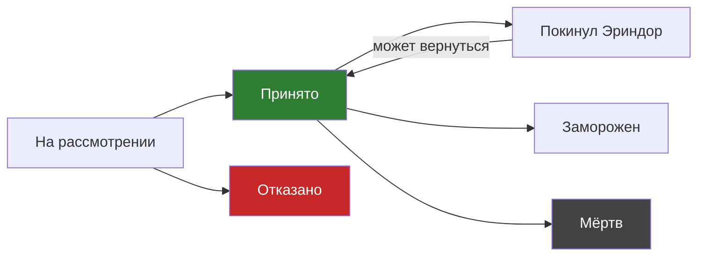
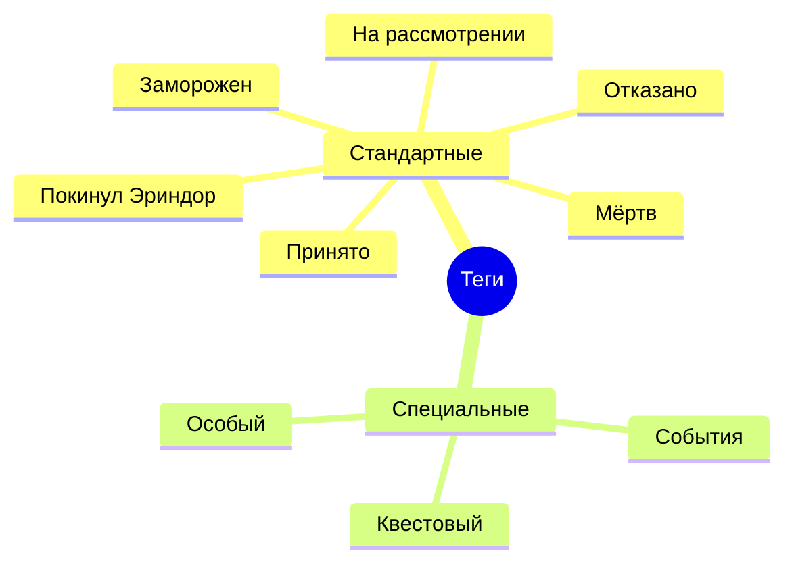

# ТЕГИ

Теги делятся на **стандартные** и **специальные**. Ставят их **только анкетологи или администрация**.

## Стандартные
- **На рассмотрении** - анкета проверяется. Пингуйте анкетологов и ждите.
- **Принято** - анкета принята, можно начинать РП. АПТК не будет.
- **Отказано** - анкета отклонена, персонажа в РП не будет. Анкету позже удалят.
- **Покинул Эриндор** - персонаж ушёл с острова, но может вернуться в любой момент (частично заморожен).
- **Мёртв** - персонаж мёртв. Его судьбу решает Апостол: пингуйте @Verba и выполняйте указания.
- **Заморожен** - РП за персонажа прекращено, действия с ним остановлены или приостановлены.

## Специальные
- **События** - злодеи, главы государств/фракций и другие персонажи, появляющиеся только на время событий или в особых случаях.
- **Квестовый** - персонажи для квестов: и созданные ради участия в квестах, и персонажи ГМов для их квестов.
- **Особый** - важные персонажи, не подходящие под остальные теги: боги, апостолы, некоторые персонажи стаффа.

**Лимит:** у персонажей с тегами «События», «Особый» и иногда «Квестовый» нет строгого лимита, но создавать их направо и налево нельзя.
