# ТОЧКИ ИНТЕРЕСА

Здесь будет актуальная карта фракций и точек контроля. *[Карта будет обновляться]*

Правила захвата и фракционные очки - в файле [Механика точек интереса](Механика%20точек%20интереса.md).

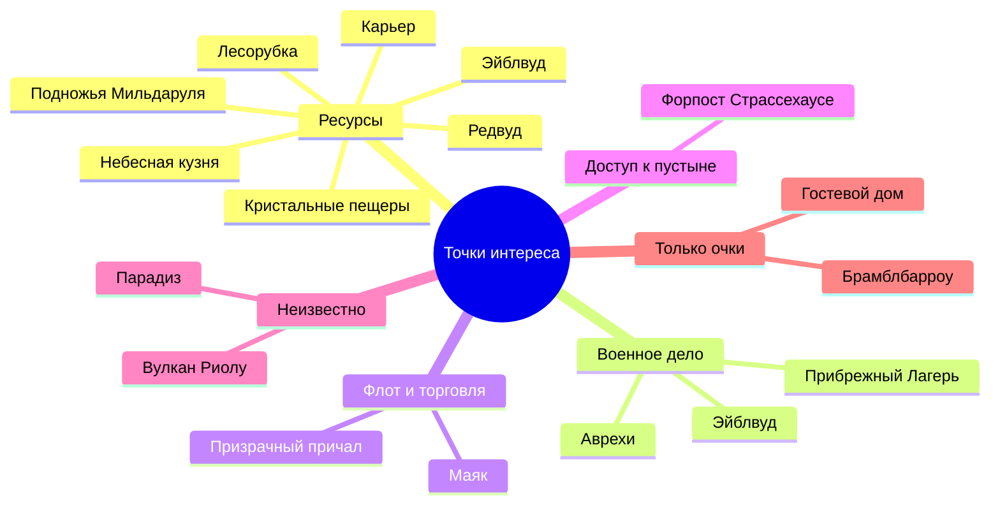

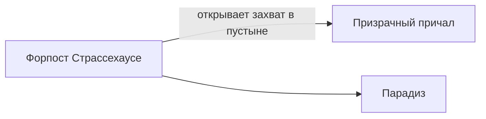

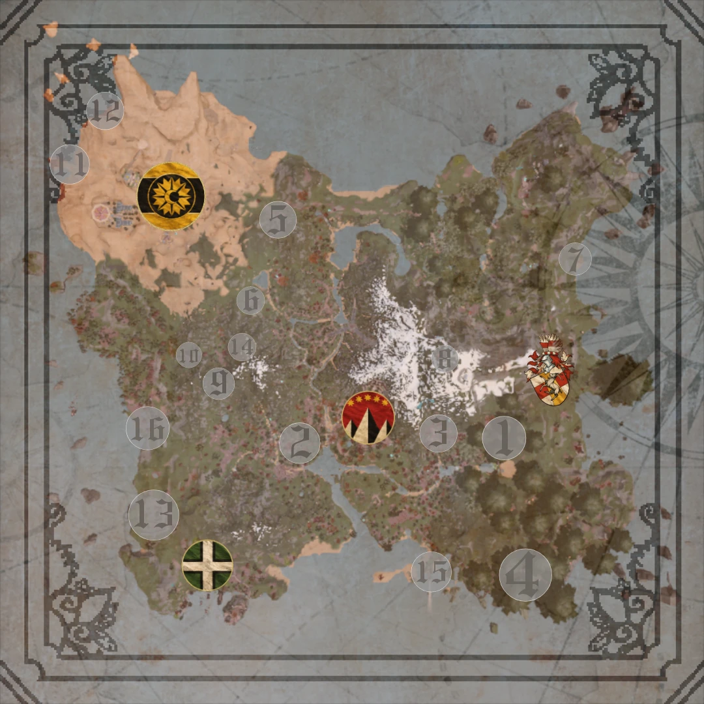

---

## [1] Эйблвуд

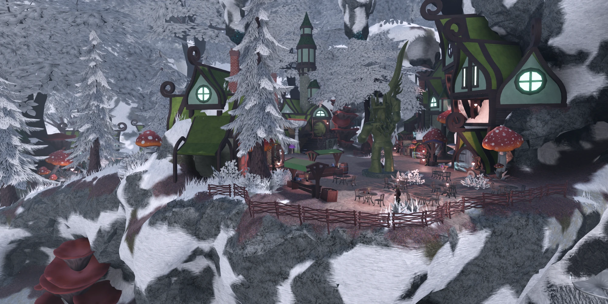

Деревня, основанная эльфами в конце 65-летней войны и первой принявшая новые законы о толерантности ко всем расам. Торговый рай, а порой и место для отдыха. Кто-то назовёт её визитной карточкой Эриндора, кто-то - живым фрагментом истории. Так или иначе, этот центр друидской магии и эльфийской жизни Эриндора крайне важен: он один из самых могущественных медицинских центров континента.

**При захвате:**
- +2 фракционных очка.
- Существенное пополнение медицинских запасов (целебных трав).
- Возможность освоить в военном деле владеющего государства класс «боевой маг».

---

## [2] Редвуд

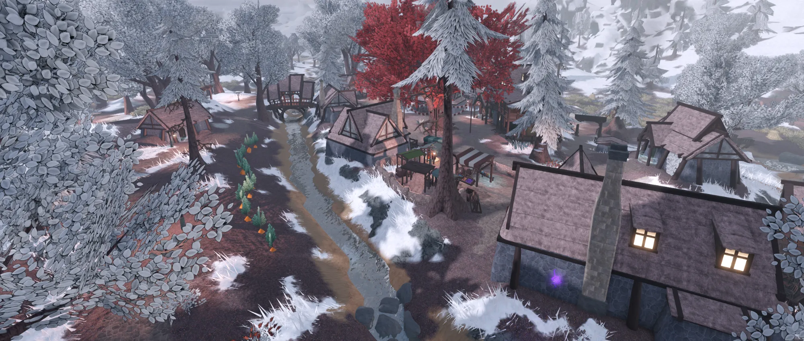

Относительно молодое и консервативное селение. Местные жители не слишком разговорчивы, но весьма радушны. Редвуд - место, где сельское хозяйство - центр вселенной. Деревушка примечательна большой диаспорой из Гардонии.

**При захвате:**
- +1 фракционное очко.
- Пока точка во владении, фракции не нужно вести учёт провизии (еды и подобных расходников).

---

## [3] Брамблбарроу

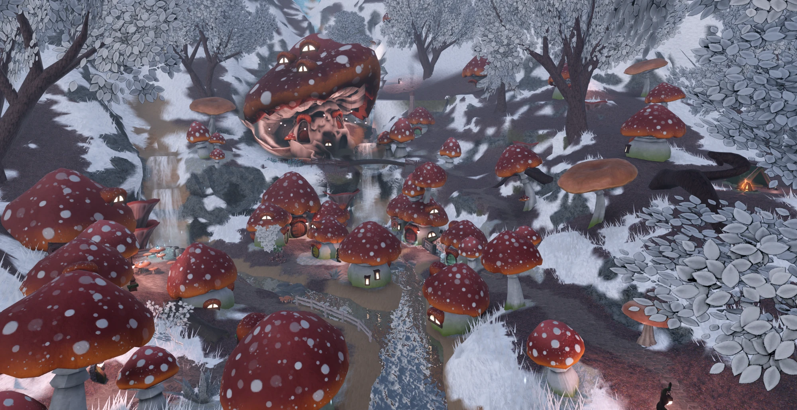

Деревня, построенная на братстве миконидов и людей. Непримечательная, но многострадальная: регулярно становилась жертвой поджогов, поэтому нуждается в охране.

**При захвате:**
- +1 фракционное очко.

---

## [4] Подножья Мильдаруля

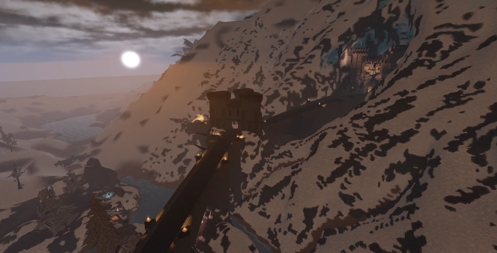

Неоднозначное и немного пугающее место. На бумаге и по заявлениям мильдарульских князей эти территории подвластны Мильдарулю, но на деле до них никому нет дела, поэтому другие лорды регулярно прибирали к рукам дела этой крепости.

**При захвате:**
- +1 фракционное очко.
- Возможность обустроить горную добычу для производства материала для инструментов.

---

## [5] Аврехи

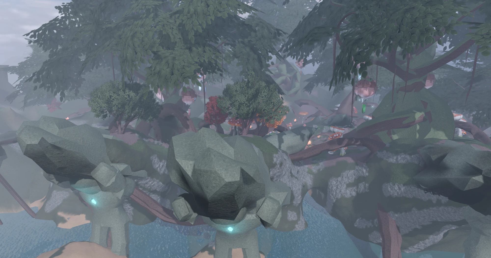

Столица «сумасшедших» - вернее, людей и эльфов, которые, по мнению других, связываются со странной магией. Нет, не тёмной. Люди в этом посёлке всегда жили магией и не представляли жизни без неё.

**При захвате:**
- +1 фракционное очко.
- Возможность освоить в военном деле владеющего государства класс «боевой маг».

---

## [7] Прибрежный Лагерь

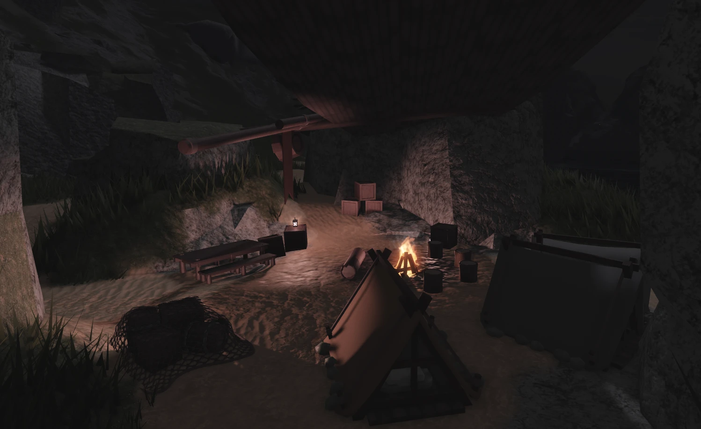

Лагерь среди камней, спрятанный под корпусом разбитого судна.

**При захвате:**
- +1 фракционное очко.
- Владение локацией позволяет контролировать округу, увеличивая численность армии.

---

## [8] Вулкан Риолу

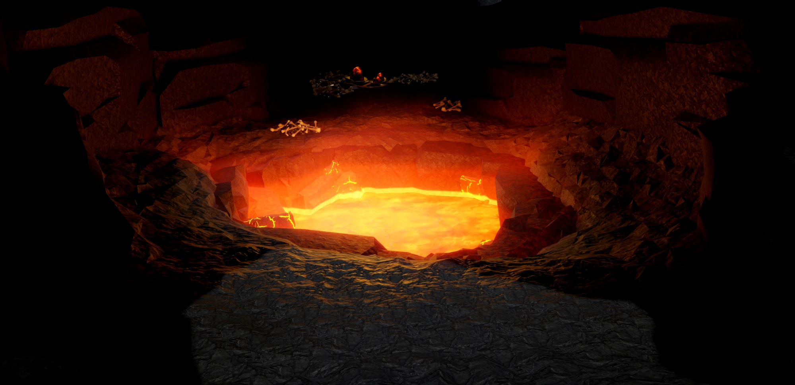

Страшное, опасное и окутанное легендами место. Чтобы попасть туда, нужно снарядить экспедицию. Неизвестно, что из этого выйдет.

**При захвате:**
- ???

---

## [9] Небесная кузня

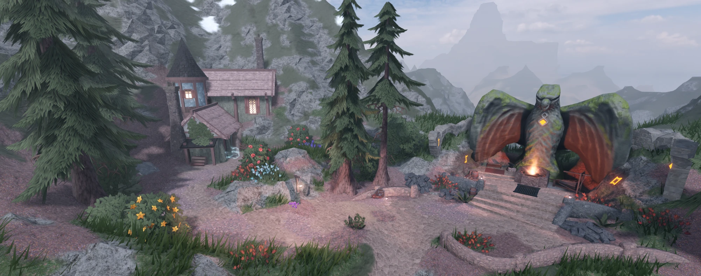

Место у подножия гор. Кузня, где сбываются мечты искусных мастеров и мечников. Поговаривают, что Скайфордж основал падший целестиал, даровавший людям огонь.

**При захвате:**
- +1 фракционное очко.
- Пока точка во владении, фракции не нужно вести учёт мечей, копий и кирок.
- Возможна «приватизация» - стоимость 200 золотых.

---

## [10] Гостевой дом

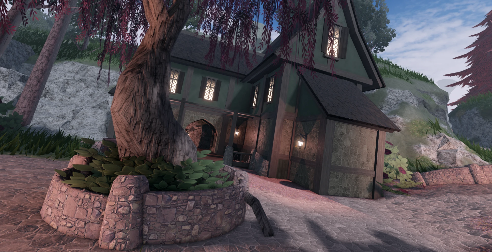

Гостевой дом на холмах. Может служить санаторием... ну или дачей для лорда.

**При захвате:**
- +1 фракционное очко.

---

## [1] Призрачный причал

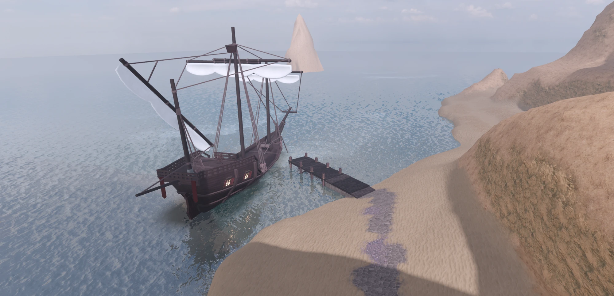

Причал в пустыне. В запасе - один вместительный корабль.

> **Может быть захвачен только при владении точкой, позволяющей захватывать точки в пустыне.**

**При захвате:**
- +1 фракционное очко.
- +1 корабль во флотилию государства.

---

## [12] Парадиз

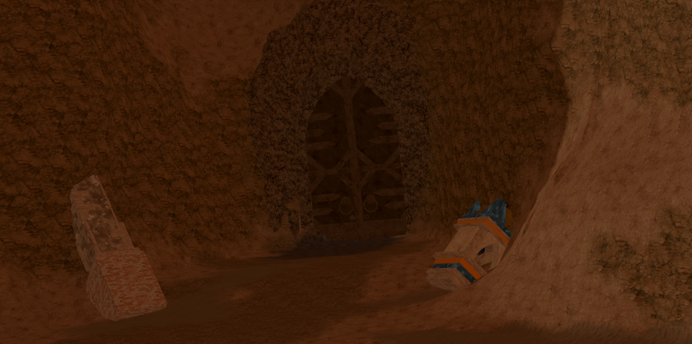

*Затеряна в песках, но не в сердцах...*

> **Может быть захвачен только при владении точкой, позволяющей захватывать точки в пустыне.**

**При захвате:**
- ???

---

## [13] Карьер

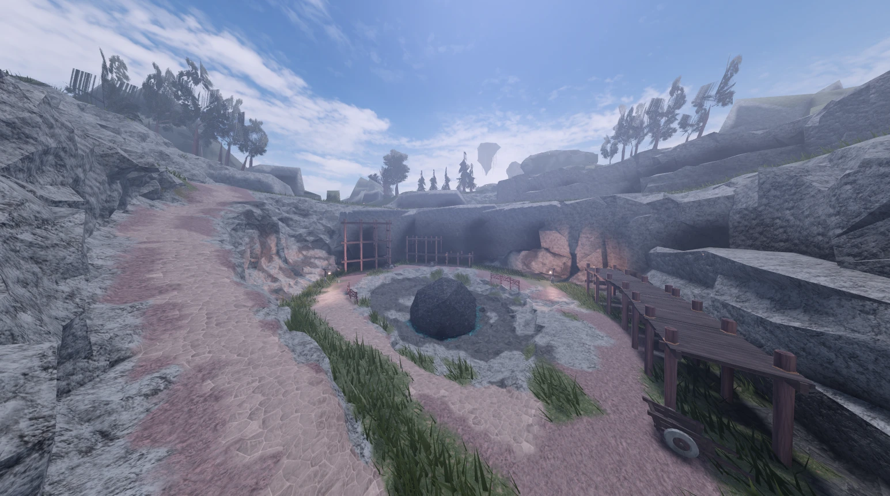

Крупное место добычи полезных ископаемых.

**При захвате:**
- +2 фракционных очка.
- Владение локацией полностью обеспечивает фракцию железом и другими ископаемыми ресурсами.

---

## [14] Кристальные пещеры

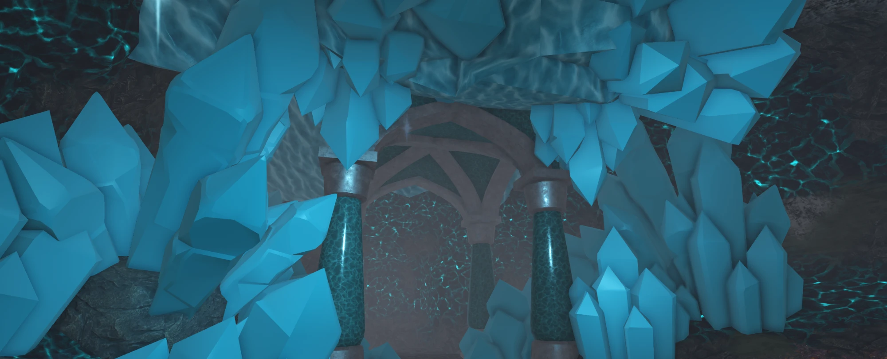

Клондайк для исследований минералов и кристаллов. Вот бы ещё договориться с местными жителями...

**При захвате:**
- +1 фракционное очко.
- Возможность добывать и изучать потенциальные драгоценности и кристаллы.

---

## [15] Маяк

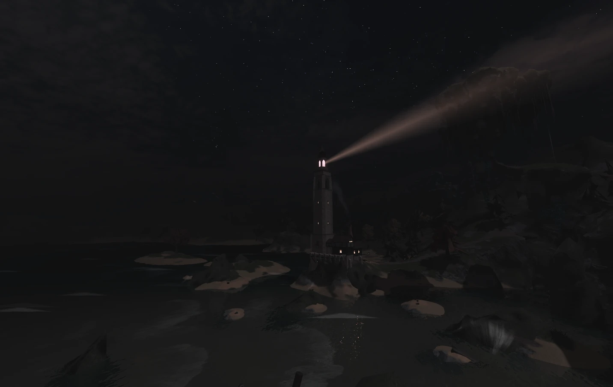

Относительно недавно построенное сооружение, по которому ориентируются корабли вокруг Эриндора.

**При захвате:**
- +1 фракционное очко.
- Бонусы к флоту и торговле.

---

## [16] Лесорубка

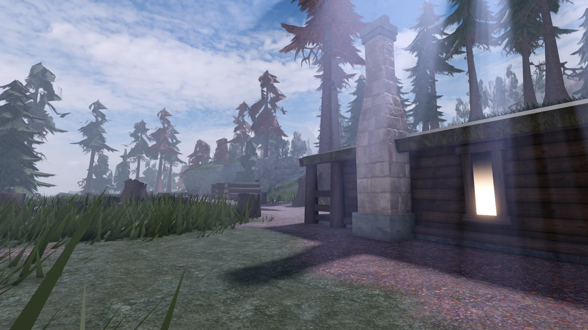

**Текущий владелец:** `@Georggg201`

Крупное место добычи древесины. Вокруг него ходят неоднозначные слухи.

**При захвате:**
- +1 фракционное очко.
- Лесорубка полностью обеспечивает фракцию древесиной.

---

## [6] Форпост «Страссехаусе»

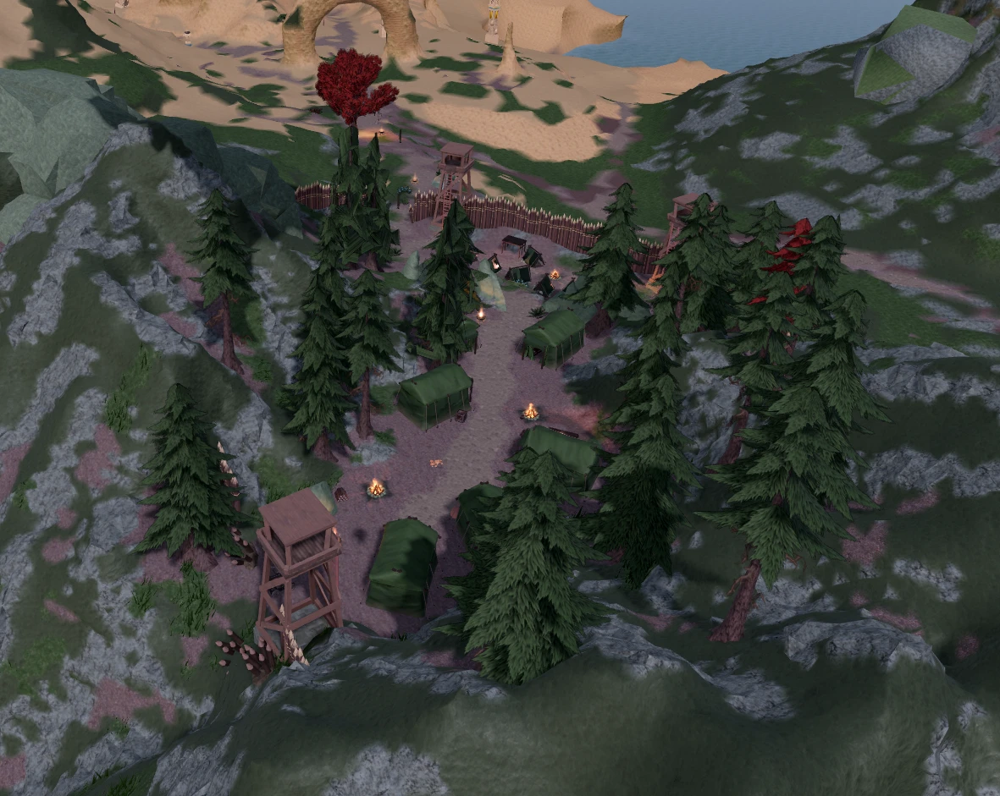

В перерывах между недолгими владыками - никому не нужный форпост. Но идеальный способ давить на пустынные государства.

**При захвате:**
- +2 фракционных очка.
- Возможность захватывать точки в пустыне.
