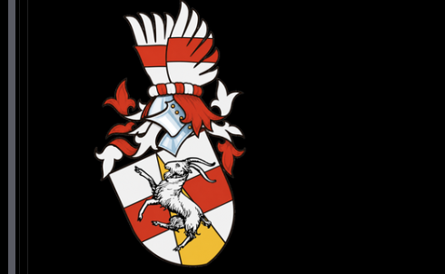

# ФРАКЦИИ

## Скалица

**Лидер:** @монолюля
**Discord:** [«Княжество Скалицкое» Mythage](https://discord.gg/tfgdwn9Jj)

- **Основание.** Княжество, впервые письменно упоминаемое около 1110 года. Основано сотней вольнорабочих во главе с **Князем Радцигом Кобылой** и **Графом Петельгейзе фон Полаффом**, которые и ныне правят крепостью Скалицкой и её окрестностями.
- **Столица.** Крепость, переходящая в подземное поселение и сеть шахт в горе. Предположительно построена во время 65-летней войны и отреставрирована вольными рабочими Радцига Кобылы. Сейчас в Скалице около **300 вольнорабочих** и **150 ополченцев** на службе.
- **Хозяйство.** Княжество обеспечивает себя огромными запасами полезных ископаемых из горы, а также плодородной землёй с мельницей. Скалица наращивает собственное производство всего необходимого - от инструментов и вооружения до собственной чеканки серебряных монет, стараясь быть независимой от остального Эриндора.
- **Служба.** Скалица готова принять на службу любого - дворянина, крестьянина или авантюриста - при условии пожизненной клятвы службы Скалице и Радцигу Кобыле. Взамен даются жильё, пропитание и жалованье, даже самым обеднённым.
- **Законы.** Свод законов суровый: воровство до сих пор карается лишением нескольких пальцев или конечности, а дезертирство - публичным повешением.
