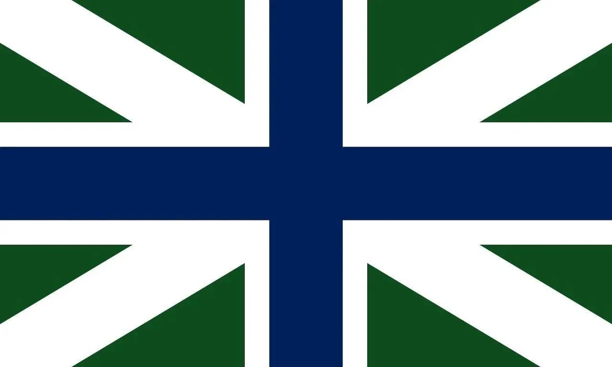
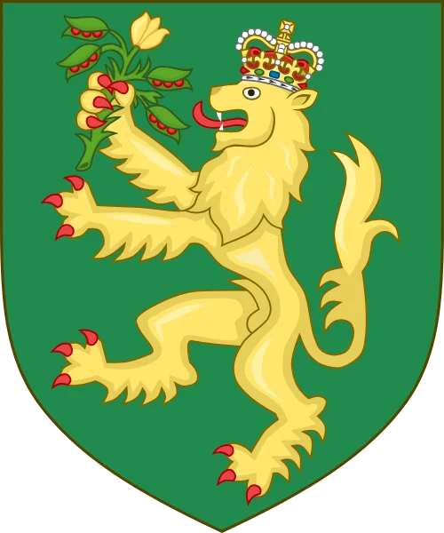
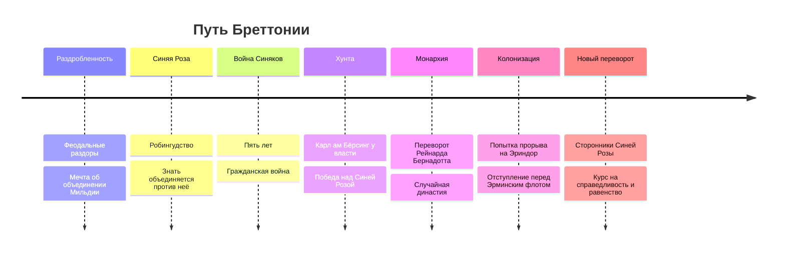
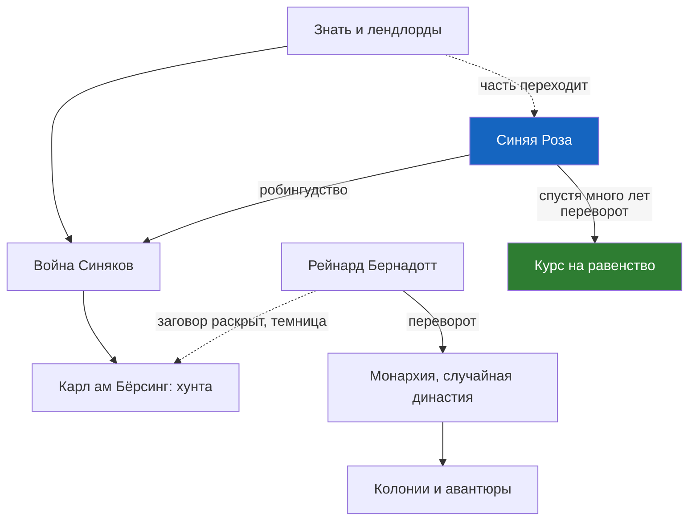
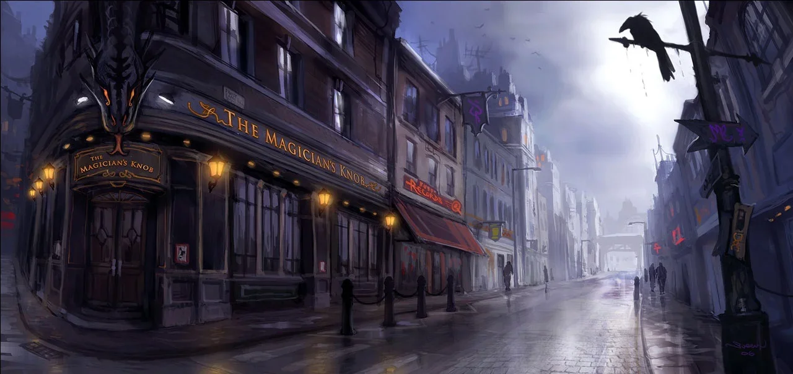
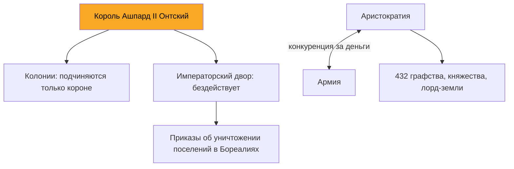
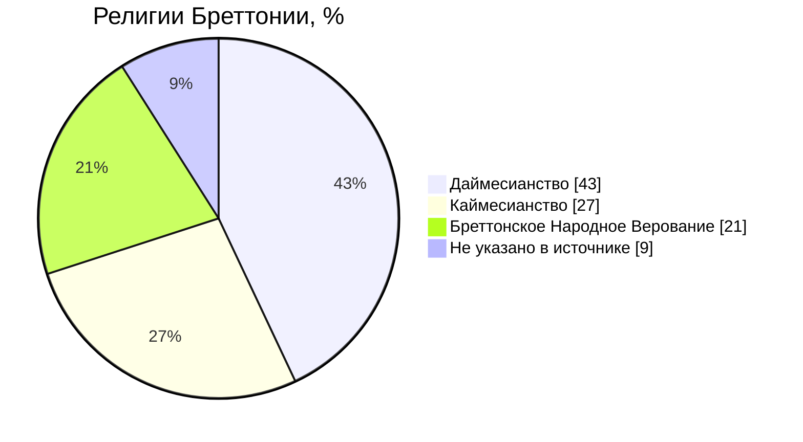

# ХРОНИКА БРЕТТОНИИ

*Бреттонская Империя. Авторы: RoyalistGeist_Larper, SUPERBRO_1111111*

 

> «Неравенство порождает сильных.»
>
> «Plura meliora sunt.» - девиз Бреттонской Империи

## История
- **Раздробленность.** Вековые раздоры и феодализм давно уничтожили единое Бреттонское государство. Единая Бреттония была мечтой феодалов и землевладельцев, которые годами стремились стать объединителем земель Левронской провинции «Мильдия» (то есть Бреттонских островов). Объединил разрозненный дом растущий национализм и любовь к родине.
- **Синяя Роза.** Появилась группа авантюристов «Синяя Роза», занимавшаяся робингудством. Это сильно не нравилось знати и лендлордам, и все объединились, чтобы их найти.
- **Война Синяков.** Группа разрасталась, итогом стала пятилетняя война. Её смысл был утерян ещё в начале, а часть лендлордов перешла на сторону Синей Розы - конфликт стал гражданской войной.
- **Бёрсинг и Бернадотт.** На другой стороне военную власть захватил **Карл ам Бёрсинг** с помощником **Рейнардом Бернадоттом**. Оба - идейные сторонники Бреттонского Юнионизма. Рейнард хотел убить Бёрсинга, но план раскрыли. Бёрсинг захватил власть и собрал всю коалицию против Синей Розы под одной крышей.
- **Восстановление.** После победы над Синей Розой государство восстановили - сначала как военную хунту. Затем Рейнард, просидев несколько лет в темнице, снова захватил власть переворотом, восстановил монархию и выбрал случайную династию с нулевым влиянием, чтобы не вызывать споров и стычек.
- **Колонии.** Страна занялась имиджем и колонизацией земель за своими пределами. Была попытка прорваться на Эриндор, но после короткой стычки с Эрминским флотом Бреттония отступила. Она быстро стала символом государства-авантюриста, сохраняющего лицо перед мировой общественностью.
- **Новый переворот.** Спустя много лет переворот сторонников Синей Розы вместе с озлобленными людьми что-то изменил: страна стала двигаться к справедливости и равенству. Процесс займёт очень долго, но дела пошли на поправку.

---

## Государство
- **Устройство.** Бесчисленное количество графств, княжеств и лорд-земель, у каждого свои границы и наместники. Точное административное деление определить невозможно, но на картах чаще всего указывают **432** единицы.
- **Колонии** подчиняются **только** короне во главе с **королём Ашпардом II Онтским**.
- **Проблемы.** Уровень жизни очень плохой: сильное классовое неравенство, коррупция и неэффективный госаппарат. Всё решают аристократия и армия, которые ещё и конкурируют между собой за деньги.
- **Контрасты.** От ярких больших поместий лордов до целых кварталов трущоб в центре столицы, где уставшие рабочие творят беспредел. Страна вроде развивается, а вроде движется назад, будущее неопределённо, реформы нужны везде.
- **Двор** бездействует и отдаёт приказы лишь на уничтожение очередных поселений в неизведанных Бореалиях.
- **Манберген** кишит филиалами банков, юридических компаний и наёмных групп - найти там опасную работу нетрудно.

---

## Культура
- **Корни.** Очень давняя и глубокая история. Раньше - собирательный этнос, но ассимиляция и объединение народов сделали культуру единой. *В реальных заимствованиях - микс англичан и ирландцев.*
- **Язык** всё ещё разрознен на диалекты, но недавно появилось понятие литературных норм, которое на них влияет.
- **Колонии.** Там доминируют свои культуры. Бреттония яростно пытается их ассимилировать, но получается очень плохо.
- **Обычаи** сильно отличаются от эриндорских. Везде в мире рыжих считают ведьмами и нечистыми, а в Бреттонии - стране с наименьшим числом брюнетов в мире - ненавидят людей с **чёрными** волосами.

### Религия
- **Даймесианство** - 43% (большинство).
- **Каймесианство** - 27%.
- **Бреттонское Народное Верование** - 21%: мультитеистичная религия, олицетворяющая богов как силы природы. Распространена в сельских районах и на севере, в самых отдалённых и изолированных местах.

