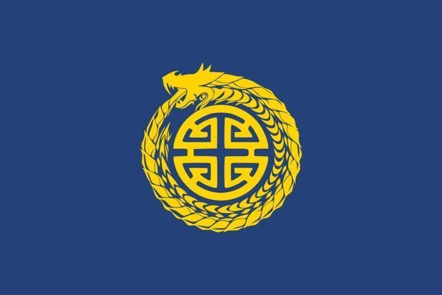
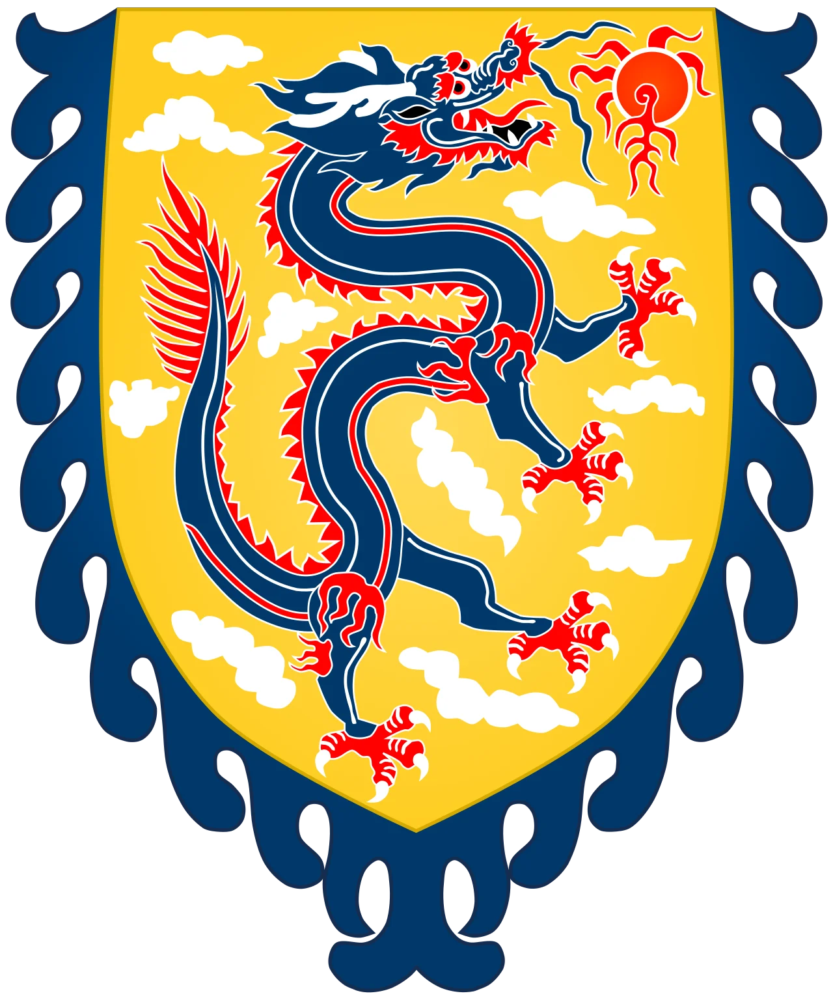
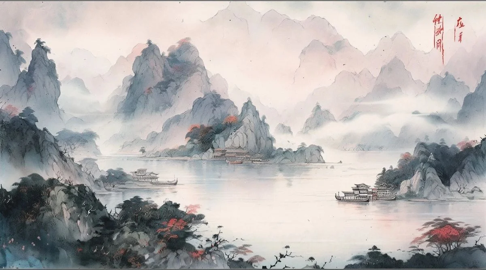
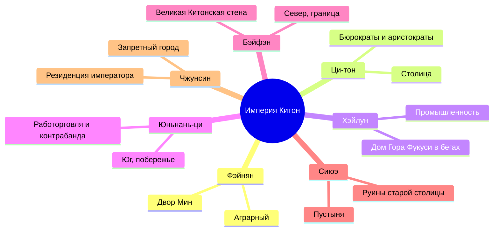
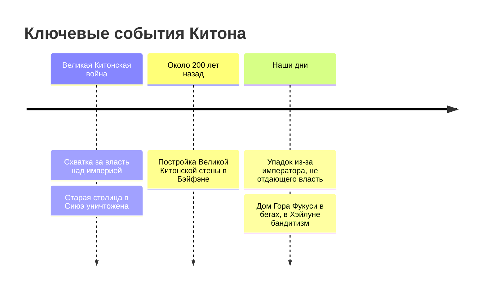

# ХРОНИКА КИТОНИИ

*Империя Китон. Автор: Unitere*

 

> «Прогресс без власти - это просто товар.»
>
> «Zhìxù. Jìnbù. Dìguó.» - девиз Империи Китон

## Общее
- Некогда великое государство, ныне в жесточайшем упадке из-за неэффективного императора, который не хочет отдавать власть даже после своей смерти.
- Основная ниша - **технологический прогресс** и продажа собственных изобретений за границу.



---

## Регионы
Китон разделён на несколько регионов, каждым правит отдельный дворец.

| Регион | Суть | Власть |
|---|---|---|
| **Фэйнян** | Аграрный регион: сельчане и деревенщины. Отсюда уезжают в большие города за славным будущим, сюда приезжают за спокойной жизнью | Двор «Мин», беспрекословно подчинён Императору |
| **Ци-тон** | Центральный регион и столица. Живут бюрократы, аристократы и богачи; сельчане - лишь на службе у чинов или как редкие торговцы с огородов. Известен скандалами об убийствах среди богатой молодёжи в борьбе за наследство | - |
| **Хэйлун** | Промышленный регион: добыча ресурсов, сталь, военные изобретения. Небо всегда серое от дыма ближайших вулканов, климат суров, жители грубые и прямолинейные | Дом «Гора Фукуси» - военная каста, формально подчинена императору, на деле живёт по своим законам. Сейчас дом в бегах, в регионе процветает бандитизм |
| **Юньнань-ци** | Южный прибрежный регион: джунгли, болота, экзотика и монстры | Сказочно богатые лорды, озолотившиеся на работорговле и контрабанде; столица не замечает этого за большие взятки |
| **Бэйфэн** | Северный пограничный регион: вечная мерзлота среди гор и степей. Около 200 лет назад здесь построили **Великую Китонскую стену** против набегов кочевников-варваров из степей. Сильно милитаризирован, место ссылки неугодных власти | - |
| **Сиюэ** | Сплошная пустыня: живут лишь оседлые старики и странники, идущие в империю. Некогда здесь была столица, но всё уничтожено в **Великой Китонской войне** за власть над империей | - |
| **Чжунсин** | Императорский домен и запретный город, открытый лишь доверенным лицам. Огромная частная резиденция императора - здание, внутри которого целый город. Славится неприступностью и огромным имперским войском внутри | Император |



```mermaid
%%{init: {"flowchart": {"htmlLabels": false}}}%%
 TD
    E["Император"] --> CH["Чжунсин: запретный город и войско"]
    E --> MIN["Двор Мин"] --> F["Фэйнян"]
    E --> CT["Ци-тон: столица"]
    E -. "формально" .-> FU["Дом Гора Фукуси"] -. "в бегах" .-> H["Хэйлун: бандитизм"]
    E -. "закрывает глаза за взятки" .-> Y["Лорды Юньнань-ци"]
    E --> B["Бэйфэн: стена и ссылка"]
    style E fill:#f9a825,color:#000
    style FU fill:#424242,color:#fff
```

---

## История



---

## Культура
Сформирована технологическим превосходством, конфликтами между дворцами и внутренней народной раздробленностью.

- **Культ изобретателя.** Инженеры и учёные уважаемы даже выше аристократов, их разработки - главное достояние государства. Продажа изобретений и технологий за границу - обычная государственная необходимость.
- **Образование.** Граждане обязаны знать основы механики и счёт. Образование общедоступно, но строго регламентировано.
- **Искусство** служит прославлению империи, свободное и неугодное творчество ограничено.
- **Религия** формальна и подчинена государству, но в народе сильно распространена вера в **Каймеса**.
- **Главные ценности:** порядок, польза и верность трону - даже если этот трон вот-вот рухнет.

### Обычаи регионов
| Регион | Обычаи |
|---|---|
| Фэйнян | Земледельческие праздники и простота нравов |
| Ци-тон | Этикет, интриги и показная роскошь |
| Хэйлун | Грубая сила, труд и прямолинейность |
| Юньнань-ци | Культы морских духов и экзотические обряды, связанные с контрабандой |
| Бэйфэн | Воинская дисциплина и память о защитниках стены |
| Сиюэ | Только обряды странников |
| Чжунсин | Культура подчинена культу Императора |

```mermaid
%%{init: {"flowchart": {"htmlLabels": false}}}%%
 LR
    T["Уважение к знанию и технике"] --> I["Культ изобретателя"]
    I --> S["Продажа технологий за границу"]
    T --> ED["Обязательные механика и счёт"]
    ST["Государство"] --> A["Искусство прославляет империю"]
    ST --> R["Формальная религия"]
    N["Народ"] --> K["Вера в Каймеса"]
```

*Грубо говоря, культура Китона - это объединение культур Китая, Кореи, Монголии, Кыргызстана, Непала, Тибета и Вьетнама.*
