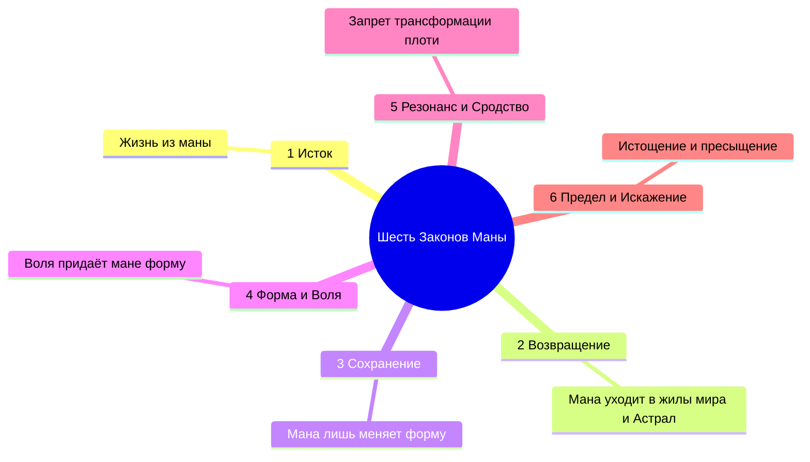
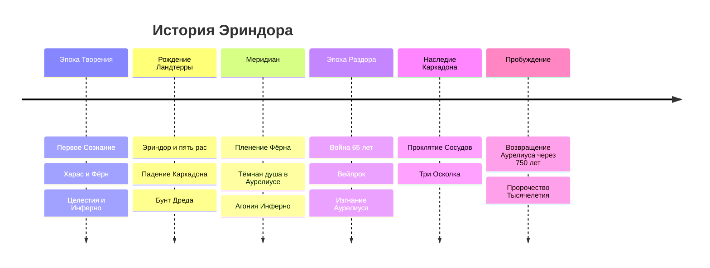

# ХРОНИКИ МИРОЗДАНИЯ: ЗАКОНЫ И ИСТОРИЯ ЭРИНДОРА

## Часть I. Шесть Законов Маны
Магия - строгая система, нарушение которой ведёт к катастрофе.

1. **Закон Истока** - любая жизнь берётся из маны. Без неё ничто не может зародиться.
2. **Закон Возвращения** - всё рождённое маной возвращается к ней. После смерти мана с памятью и опытом уходит в «жилы мира» или Астрал и даёт новую жизнь. Вернуть душу нельзя - получится лишь пустая оболочка, бездумный скелет.
3. **Закон Сохранения и Преобразования** - мана не возникает из ниоткуда и не исчезает, а меняет форму. Любое чародейство требует поглотить и преобразовать ману и меняет баланс вокруг.
4. **Закон Формы и Воли** - чистая мана хаотична и нейтральна; форму ей дают воля, разум, сильные чувства или природные матрицы.
5. **Закон Резонанса и Сродства** - подобное притягивает подобное. У каждого существа и места свой «оттенок» маны. Смешение конфликтных типов (например, Тёмной и Священной) без идеального баланса ведёт к взрыву, мутациям или разрушению.
   - **Абсолютный запрет трансформации плоти:** нельзя пришить чужие крылья, пересадить чужую руку или создать из маны новые конечности - чужая мана и плоть будут отторгнуты. Такие опыты связаны с Тёмной Магией и всегда необратимо калечат тело и рассудок.
6. **Закон Предела и Искажения (Баланса)** - пресыщение разрушает так же, как истощение.
   - Без маны земля становится мёртвой пустошью, существа гибнут от магического голода.
   - Избыток маны искажает реальность: аномалии, монстры-мутанты, прорывы стихийных аэронов.

**Применение:** маги и лекари бережно направляют потоки энергии; некромантия - грубое нарушение Закона Возвращения; массовая боевая магия выжигает регионы, оставляя мёртвые «пустоты».



## Часть II. Эпоха Творения и Первых Богов
- Из первородного хаоса маны родилось **Первое Сознание**. Оно взяло под контроль Чистилище и построило обитель в **Герасе** (ныне Астральные Грёзы).
- Сознание создало братьев: праведного творца **Хараса** и завистливого разрушителя **Фёрна**.
- В битве братья разрушили половину замка Сознания, и оно заперло их в отдельных измерениях:
  - **Целестия** Хараса - мир покоя, светлые существа, мотыльки, бабочки, благородные звери.
  - **Инферно** Фёрна - реки лавы, его трон; из маны он мог создавать лишь скелетов, слизь и слепых летучих мышей.
- Харас был готов простить брата, но Фёрн напал на Целестию. Война длилась эпоху: Целестия выжжена дотла, творения Фёрна уничтожены.

## Часть III. Ландтерра, грех Первенца и бунт Колоссов
- Сознание освободило Хараса за то, что он не стал мстить. Харас создал **Вселенную**, планету **Ландтерру** и континент **Эриндор**, населив его пятью расами: люди, эльфы, орки, зверолюды, дварфы.
- От союза человека и эльфа родилась **Мессия**. Харас дал ей силу, нарёк Богиней Любви и взял в жёны (храм их свадьбы стоит на Эриндоре). Их сыновья: старший **Каркадон** и близнецы **Каймес** и **Даймес**. Дети с позволения отца жили среди смертных, сохранив силу.

**Падший Сын и Первый Друид**
- Каркадон считал, что смертные достойны сами управлять тканью мироздания.
- Против воли отца он сделал своим учеником друида **Аурелиуса** (поклонявшегося Эриндору как деве с волосами из цветущей лозы) и научил его управлять чистой маной, удобрять почву и даже возвращать жизнь в мёртвую плоть.
- Харас в гневе сразился с сыном. Каркадон тяжело ранил вставших на сторону отца близнецов. Харас сокрушил первенца и низверг его в Инферно на растерзание порождениям Фёрна. Аурелиус тайно продолжил изучать запретные знания.

**Восстание Дреда**
- Дворец Хараса охраняли **Колоссы** - высшие целестиалы, способные становиться 30-метровыми живыми доспехами из сияющего металла.
- Командир **Дред** разделял идеи Каркадона (по-своему), счёл Хараса тираном и поднял мятеж; за ним пошли десятки Колоссов.
- Мятежники превратились в титанов из живого мяса - **Плотекованных (Багровых Исполинов)**. Началась гражданская война; Дред пытался убить Хараса, проиграл и был изгнан с выжившими на Ландтерру.
- Дред скрывается среди людей в неизвестном облике; в городах прячутся его спящие последователи.
- **Наследие:** павшие стальные Колоссы стали прообразом механоидов, а одичавшие потомки Плотекованных - расами Гигантов, Троллей и Голиафов.

```mermaid
%%{init: {"flowchart": {"htmlLabels": false}}}%%
 TD
    S["Первое Сознание"] --> H["Харас"]
    S --> F["Фёрн"]
    H --- M["Мессия, Богиня Любви"]
    H --> K["Каркадон"]
    H --> KA["Каймес"]
    H --> D["Даймес"]
    M --> K
    M --> KA
    M --> D
    K -. "ученик" .-> A["Аурелиус"]
    H -. "стража" .-> C["Колоссы"]
    C -- "мятеж Дреда" --> P["Плотекованные"]
    C -- "прообраз" --> MECH["Механоиды"]
    P -- "потомки" --> R["Гиганты, Тролли, Голиафы"]
```

## Часть IV. Меридиан, пленение Фёрна и Тёмный Осколок
- В 20 лет близнецы захотели своё измерение и тайно обратились за советом к Фёрну. Тот передал им часть своей маны сквозь барьер и внушил, что сила в технологиях и прогрессе.
- Так возник **Меридиан** - многослойное измерение на орбите Ландтерры над Эриндором: холодный космос с исполинскими шестернями, платформами и механизмами размером с города. Близнецы взяли титул **Колоссусов**.
- Двигатель Меридиана работает на звёздной радиации, космической пыли, цезии и божественной мане; буровые лазеры добывают руду из астероидов и самого пространства. Обслуживают механизмы бездушные **механоиды** (по образу Колоссов) и тайно завербованные люди-механики с Ландтерры.
- Атмосфера внешних шестерней стала ядовитой (масло, цезий, радиация), и Даймес построил **Меридианово Колесо** - герметичную кольцевую станцию для рабочих.
- На ужине в честь 30-летия возрождения Целестии Каймес проговорился. Харас отрёкся от близнецов и запретил им спускаться на Ландтерру, особенно на Эриндор.

**Разлом Души**
- Чтобы вернуть милость отца, близнецы под видом кающихся пришли к Фёрну, схватили его, перенесли в руины Гераса в Астрале, сковали тело и раскололи душу на **Светлую** и **Тёмную** половины.
- Выброс энергии разрушил все межпространственные мосты. **Тёмная половина** ускользнула и упала на Ландтерру.
- Брешь не пропускала обоих, и кто-то должен был держать печать. Каймес вытолкнул Даймеса на орбиту доводить Меридиан, а сам остался в Астрале владыкой-надзирателем над телом и Светлой душой Фёрна.
- Тёмную душу притянул **Аурелиус** и, опираясь на знания Каркадона, запечатал её в себе. Он стал сильнейшим Архимагом в истории смертных, но в нём поселилось спящее ядро бездны.

**Агония Инферно**
- Без Фёрна небо Инферно стало багровым, барьер покрылся несокрушимым чёрным наростом - **сталимагмицием**, жар стал невыносимым.
- Началась война **Лоялистов** и **Мятежников**; мана мутировала, обитатели обрели демонический облик (рога, кожистые крылья, огненные глаза).
- Лоялисты одержали пиррову победу: ядра и обелиски лопнули, храм Фёрна взорван, раса **Титанов** истреблена. Кровь питает чёрные наросты, и они разрастаются.

```mermaid
%%{init: {"flowchart": {"htmlLabels": false}}}%%
 TD
    F["Фёрн"] -- "пленён близнецами" --> G["Руины Гераса в Астрале"]
    G --> L["Светлая половина души"]
    G --> T["Тёмная половина души"]
    L -- "стережёт" --> KA["Каймес, владыка Астрала"]
    T -- "падает на Ландтерру" --> A["Аурелиус запечатывает её в себе"]
    D["Даймес"] -- "вытолкнут на орбиту" --> MER["Меридиан"]
```

## Часть V. Эпоха Раздора и трагедия Вейлрока
- Не зная о выходке близнецов, Харас обвинил смертных и изгнал людей и эльфов из Целестии на Ландтерру. На небесах остались лишь **Ангелы** - дети Мессии.
- Люди и эльфы обвинили друг друга, началась война всех рас на 65 лет. За предательство единства Харас покарал смертных: разделил их цветом кожи, языками, религиями и разбросал по изолированным регионам.

**Возвышение и падение Аурелиуса**
- Аурелиус основал **Вейлрок** - независимое княжество-академию для лучших умов всех рас, защищённое магическим барьером от орков и варваров.
- Печать стала трескаться. Совет Магов, боясь тьмы в Архимаге, решил убить его во сне.
- Пробудившаяся Тёмная душа Фёрна защитила Аурелиуса: он испепелил сотни элитных магов и членов Совета.
- Сломленный предательством, он отрёкся от Эриндора и ушёл в Инферно - на зов этого измерения и на поиски Каркадона. Харас был недоволен, но вмешиваться не стал.

## Часть VI. Наследие Каркадона
- Сто лет Каркадона терзали в Инферно, пожирая его ману. Во время гражданской войны он разорвал оковы и скрылся в глубинах измерения.
- **Проклятие Сосудов:** Каркадон пустил по жилам Ландтерры проклятие - избранный смертный может накапливать огромные объёмы маны, чтобы потом Каркадон её забрал, осушив носителя. Тысячу лет раз в 50 лет рождается одно такое дитя. Сведения о них - лишь редкие записи в закрытых архивах Вейлрока.

**Три Осколка Сознания Каркадона**
Теряя себя в заточении, Каркадон исторг частицы разума в мир, но его личность раскололась на три части, вселившиеся в смертных:
1. **Чёрный Глаз** (Идеология и Мщение) - сначала в некоем Фоллене, затем перешёл к **Габриэлю Логану** при его перерождении в **Немезиса** и сформировал его радикальные идеи.
2. **Алый Король** (Власть и Фанатизм) - таинственный глава могущественного фанатичного культа.
3. **Орекс** (Хладнокровие и Коварство) - младший брат Снежного Короля, внешне и по магии его копия. Чистое прагматичное зло, психопат и кукловод без эмпатии, никогда не запугивает напрямую.

## Часть VII. Пробуждение и Пророчество Тысячелетия
- Через 750 лет Аурелиус вернулся на Эриндор как последнее и самое страшное порождение Ада. К нему стекаются остатки творений Фёрна - от высших вампиров до скелетов. Он обещает им величие, скрывая истинные мотивы (известные лишь ему и Каркадону).
- **Пророчество:** через тысячу лет после первой победы над злом легионы Инферно придут на Эриндор, пустой трон займёт новый тёмный владыка. Ни одно королевство не выстоит в одиночку. Надежда - лишь если люди, эльфы, орки, дварфы и зверолюды преодолеют ненависть, гордыню и языковой барьер и встанут вместе. Тогда тирания бездны падёт, Харас вновь обратит взор на Ландтерру, и на Эриндоре настанет вечный мир.

*Продолжение следует...*



## Религии Эриндора

### I. Канон Всеотца (Ортодоксальное Харасианство)
- Государственная религия большинства людских королевств и эльфийских уделов. Суровая вера в древнюю вину и строгое соблюдение Шести Законов.
- Учение: расы предали завет единства в Войне Раздора; молчание Хараса - испытание.
- Харас - грозный Судья, поэтому простой народ чаще молится **Мессии** (Плачущей Деве, Заступнице) о дожде, любви, исцелении.
- Нарушение Закона Возвращения (некромантия) или Закона Сродства (сшивание плоти, мутации) - костёр. Еретиков ищут **Дознаватели** - инквизиторы в белых плащах.
- Символика: белый мрамор, высокие своды, колокола. Символ - Золотое Кольцо Единения в шестиконечной звезде. Жрецы в белых рясах с золотым шитьём.

### II. Даймесианство (Орден Движущей Силы)
- Молодая, быстро растущая вера; поклоняются **Даймесу** - Перводвигателю, Великому Архитектору, Меха-Империуму.
- Популярна у дварфов-инженеров, ремесленных цехов, алхимиков, артиллеристов и учёных Вейлрока.
- Учение: Харас создал мир из несовершенной плоти; Даймес не предал отца, а пошёл дальше, построив мир вечного движения. Служи прогрессу, отсекай лишние чувства - и после смерти твоя мана вольётся в Движущую Силу Меридиана.

### III. Каймесианство (Завет Вечной Стражи)
- Суровый воинский культ (в народе - Дозор Последней Цепи), почитающий **Каймеса** - тюремщика Астральных Грёз.
- Храмы - заставы, гарнизоны, маяки, склепы. Последователи - наёмники, латники, охотники на чудовищ, маги-сновидцы.
- Каймес для них - единственный бог, не отвернувшийся от мира. Вера долга и самоотречения: просят не милости, а стойкости.
- Фанатично защищают Закон Возвращения, истребляют некромантов и демонологов. Вступающий заковывает на левом запястье железное звено.
- Символика: опущенный остриём вниз бастард, обвитый серебряной цепью, на тёмно-фиолетовом знамени.

### IV. Церковь Первородного Дара
- Самое двуличное и опасное течение, основанное странствующим священником **Отцом Малахией**. Почитает «Первого Учителя», отдавшего смертным «ключи от неба».
- Два лица: для народа и стражи - и для избранных в подвалах.
- Внешне - бедная милосердная община: часовни и приюты в трущобах, портах и разорённых деревнях, помощь голодным и изгоям всех рас, проповедь прощения и «внутреннего дара души». Власти считают их безобидными.
- **Им принадлежит церковь в Хальмштадте.**

```mermaid
%%{init: {"flowchart": {"htmlLabels": false}}}%%
 LR
    R1["Канон Всеотца"] --> G1["Харас и Мессия"]
    R2["Даймесианство"] --> G2["Даймес"]
    R3["Каймесианство"] --> G3["Каймес"]
    R4["Церковь Первородного Дара"] --> G4["Первый Учитель"]
```
